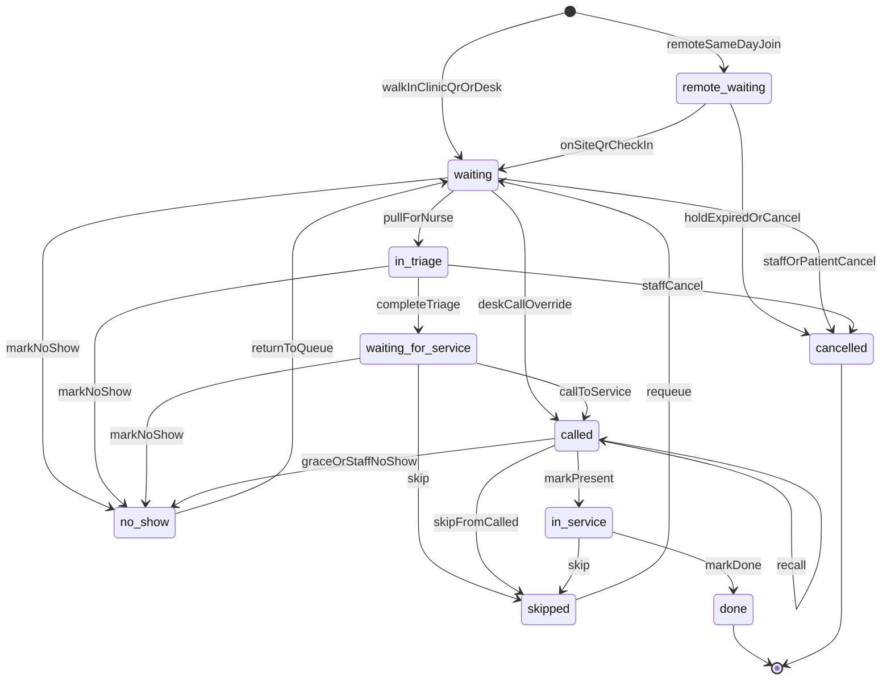
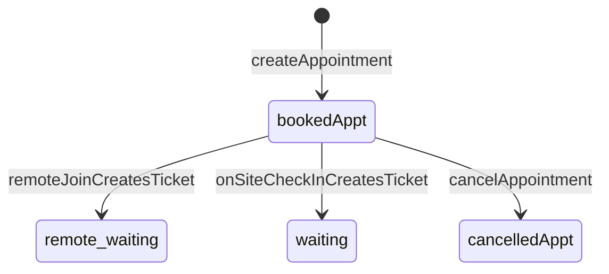

# CareQ ticket flow (phone-only)

Companion to [`docs/requirements.md`](requirements.md). Describes the **target** state machine and who may trigger each transition.

---

## Booked vs ticket (resolved)

- **`booked` is an appointment / check-in status**, not a live queue ticket.
- Appointments live on `checkins` (or equivalent) while reserved (`pending` / booked semantics).
- A **queue ticket row exists only from `remote_waiting` onward** (remote join, walk-in QR/desk, or on-site check-in that enqueues).
- Transitions labeled “from booked” below mean: **appointment record → create/enqueue ticket** into `remote_waiting` or `waiting`.

---

## State machine (live tickets)

### Appointment (non-ticket) path

Notes:

- Nurse **pull:** `waiting` → `in_triage` (preferred without TV call). TV “Now Calling” for service `called` unless clinic enables triage display.
- **Recall:** stays in `called`; max N per clinic setting.

---

## Transitions by role

### Appointment / checkin (not queue ticket)

| From | To | Trigger | Allowed roles |
|------|-----|---------|----------------|
| — | appointment `booked` | Create appointment | `patient`, `guardian`, `receptionist`, `admin` |
| appointment `booked` | ticket `remote_waiting` | Remote same-day join (creates ticket) | `patient`, `guardian` |
| appointment `booked` | ticket `waiting` | On-site clinic QR check-in (creates ticket) | `patient`, `guardian` (+ staff assist) |
| appointment `booked` | cancelled | Cancel appointment | `patient`, `guardian`, `receptionist`, `admin` |

### Live queue tickets

| From | To | Trigger | Allowed roles |
|------|-----|---------|----------------|
| — | `remote_waiting` | Remote same-day join (no prior booking) | `patient`, `guardian` |
| — | `waiting` | Walk-in via clinic QR / desk create | `patient`, `guardian`, `receptionist`, `admin` |
| `remote_waiting` | `waiting` | On-site clinic QR check-in | `patient`, `guardian` (+ staff assist) |
| `remote_waiting` | `cancelled` | Hold expired | `system` |
| `remote_waiting` | `cancelled` | Cancel | `patient`, `guardian`, `receptionist`, `admin` |
| `waiting` | `in_triage` | Pull for nurse | `nurse`, `receptionist`, `admin` |
| `waiting` | `called` | Desk call override | `receptionist`, `nurse`, `doctor`, `admin` |
| `waiting` | `no_show` | Mark no-show | `receptionist`, `nurse`, `doctor`, `admin` |
| `in_triage` | `waiting_for_service` | Complete triage | `nurse`, `receptionist`, `admin` |
| `waiting_for_service` | `called` | Call to room | `doctor`, `receptionist`, `nurse`, `admin` |
| `called` | `called` | Recall (≤ max N) | `doctor`, `receptionist`, `nurse`, `admin` |
| `called` | `in_service` | Mark present | `doctor`, `receptionist`, `nurse`, `admin` |
| `called` | `no_show` | Grace or staff | `system`, staff as above |
| `called` / `in_service` / `waiting_for_service` | `skipped` | Skip | staff as above |
| `skipped` | `waiting` | Re-queue | `receptionist`, `nurse`, `admin` |
| `no_show` | `waiting` | Return to queue | `receptionist`, `nurse`, `admin` |
| `in_service` | `done` | Mark done | `doctor`, `receptionist`, `nurse`, `admin` |

Queue mutations: **Postgres functions** that verify **`clinic_id` + caller role**. Until those exist: service-role paths must still **filter by clinic_id and verify caller clinic**.

---

## Notification hooks

| Event | Notify |
|-------|--------|
| Enter `remote_waiting` | Optional confirm |
| Hold approaching expiry | Optional warning |
| Position ≤ clinic `approaching_threshold` (default **3**) | Approaching (Web Push → SMS fallback) |
| Enter `called` | Called (Web Push → SMS fallback) + TV |
| Enter `done` | Optional follow-up (later) |

---

## Priority when selecting “next”

1. Booked patients **inside slot window** among eligible tickets.
2. Then by check-in / `waiting_since` ascending.
3. Optional priority tiers per clinic settings.
